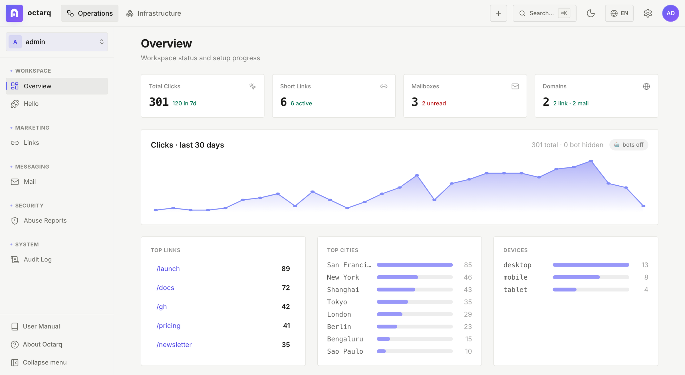
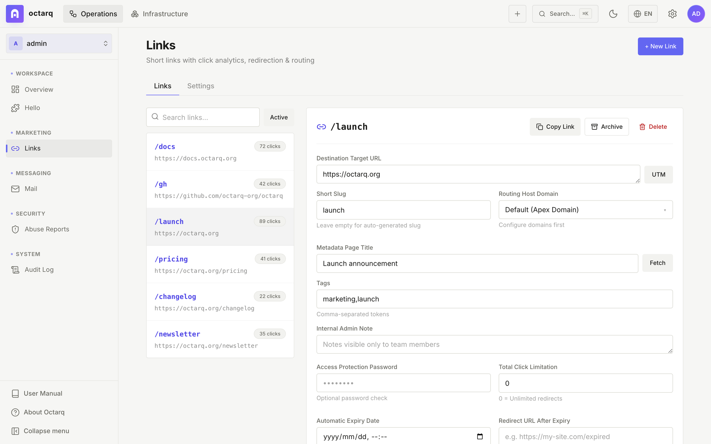
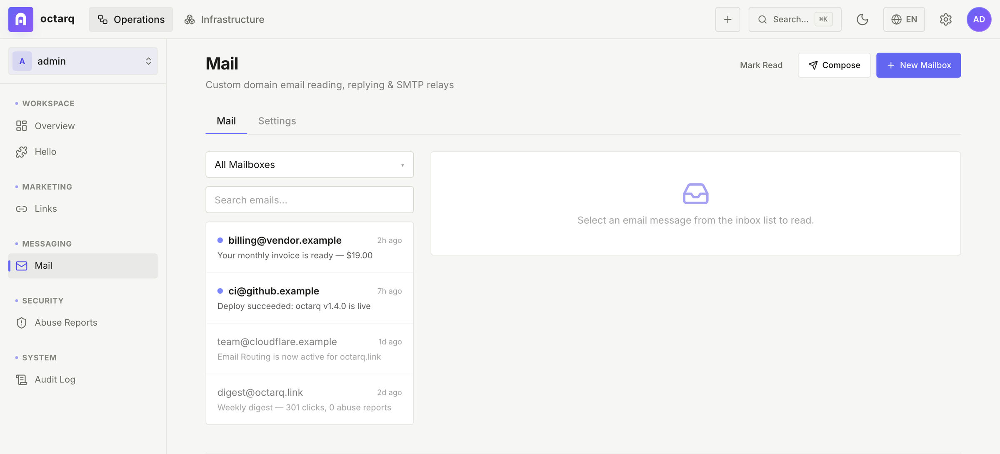
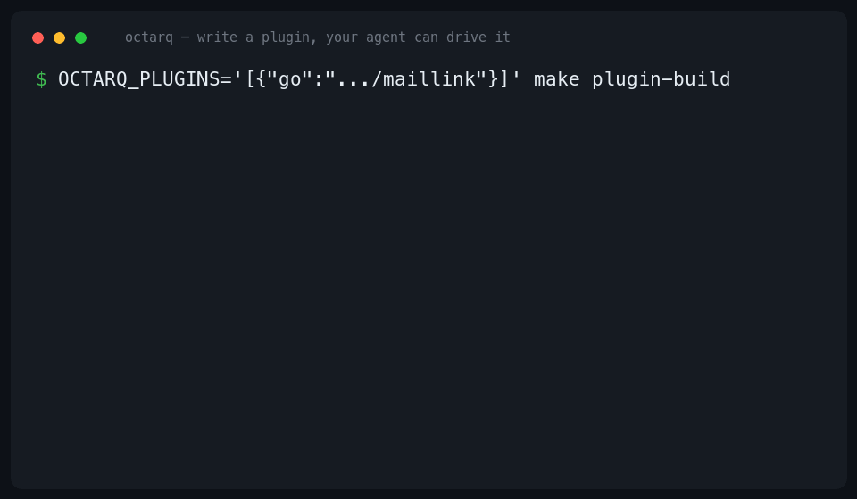

<p align="center">
  <picture>
    <source media="(prefers-color-scheme: dark)" srcset="assets/banner-dark.png">
    
  </picture>
</p>

<p align="center">
  <b>One Go binary. Infrastructure, not vertical features. Add links, email and DNS as plugins — and drive them from your AI agent over MCP.</b>
</p>

<p align="center">
  <a href="https://github.com/octarq-org/octarq/actions/workflows/ci.yml"></a>
  <a href="https://github.com/octarq-org/octarq/actions/workflows/ci.yml"></a>
  <a href="server/go.mod"></a>
  <a href="https://pkg.go.dev/github.com/octarq-org/octarq/server"></a>
  <a href="https://modelcontextprotocol.io"></a>
</p>

<p align="center">
  <a href="https://octarq.org">Website</a> ·
  <a href="https://docs.octarq.org">Docs</a> ·
  <a href="#quick-start">Quick start</a> ·
  <a href="blueprints/autonomous-solopreneur/">Solopreneur Blueprint</a> ·
  <a href="#extend-it-write-a-plugin">Write a plugin</a> ·
  <a href="https://github.com/octarq-org/octarq-plugins">Plugins</a> ·
  <a href="README_ZH.md">简体中文</a>
</p>

---

## What is Octarq?

Octarq is **a self-hosted back office you compose**, for indie hackers, one-person companies, and small AI-native teams. One Go binary supplies the layers every back office needs, and you mount the business features you want on top.

**What core provides** — no business feature among them:

| Layer | What you get |
| --- | --- |
| Identity | Sign-in, API tokens, workspaces, roles, and a tenant-scoped database layer |
| Operations | Audit log, notifications, background job queue, webhooks, backups |
| Agent | MCP server, per-tool risk levels, read-only SQL over tenant views, tier gating |
| Platform | Plugin SDK for Go and React, embedded dashboard, OpenAPI export, tenant SQL views |

Business features live in [octarq-plugins](https://github.com/octarq-org/octarq-plugins): links, mail, DNS, and a 2FA vault. Add the ones you need at build time. Extend the rest the same way: **a small Go interface + a React page = a new tool in your back office.** Because Octarq speaks **MCP**, every plugin you add is instantly drivable by your AI agent (Claude Code, Cursor, Claude Desktop).

Three ways to use it:

1. **Run it** — `docker compose up -d --build`, then sign in.
2. **Compose a build** — `OCTARQ_PLUGINS='[...]' make plugin-build` picks plugins without editing code.
3. **Write a plugin** — three Go methods and a React page, and you get DB, auth, audit, MCP and the dashboard shell for free.

> One binary. No CGO. SQLite by default. `go:embed`'d dashboard. Extend without forking.

<p align="center">
  
</p>

---

## Quick start

Octarq publishes no container image: a useful build carries the plugins you
pick, so you build one. Docker Compose builds the binary and the dashboard from
this tree:

```bash
git clone https://github.com/octarq-org/octarq && cd octarq
docker compose up -d --build
```

Or build the binary without Docker:

```bash
make release                                                # builds ./octarq with the dashboard embedded
OCTARQ_SECRET_KEY=… OCTARQ_ADMIN_PASSWORD=… ./octarq        # serves on :8080
```

Without environment variables, Octarq generates a secret key and an initial
`admin` password on first boot. Both live in the `/data` volume. Read the
password out of the container:

```bash
docker compose cp octarq:/data/octarq-admin-password.txt .
cat octarq-admin-password.txt
```

Open `http://localhost:8080` and sign in.

The default build contains infrastructure only. Add the business plugins you
want from [octarq-plugins](https://github.com/octarq-org/octarq-plugins), then
rebuild — see [Extend it](#extend-it-write-a-plugin). A minimal image that
copies a finished binary lives in
[`deploy/Dockerfile.binary`](deploy/Dockerfile.binary).

---

## Why Octarq

- **One binary, one afternoon.** Download it, run it, extend it. No runtime to install, no services to wire together, no CGO.
- **Core is infrastructure.** Auth, workspaces, audit log, notifications, webhooks, job queue, MCP — the parts every back office needs, and nothing you would replace.
- **Business features are plugins.** Links, mail, DNS and 2FA ship in [octarq-plugins](https://github.com/octarq-org/octarq-plugins) and mount at build time. They use the same public interface you get.
- **Agent-native by construction.** Every plugin's capabilities reach your AI agent over MCP without extra plumbing.
- **Yours.** Your server, your database, your domain, MIT-licensed.

---

## Business plugins

Install these from [octarq-plugins](https://github.com/octarq-org/octarq-plugins):

| Plugin      | What you get                                                                                                                                                                                                                   |
| ----------- | ------------------------------------------------------------------------------------------------------------------------------------------------------------------------------------------------------------------------------ |
| **🔗 Links** | Custom/random slugs, geo/device/OS/language routing, expiration & click limits, expired-URL fallbacks, time-series analytics with bot detection, UTM builder, QR codes, tags (optional MaxMind GeoIP).                         |
| **✉️ Mail**  | Serverless inbound mail via Cloudflare Email Routing (no port 25, no spam daemons), catch-all auto-provisioning, a full client (read/reply/send over your SMTP relays, download raw `.eml`), on-demand AI summaries (BYO key). |
| **🌐 DNS**   | Cloudflare & DNSPod CRUD, subdomain presets for short-link + email auth (MX/SPF/DKIM), native comment/notes mapping.                                                                                                           |
| **🔐 2FA vault** | TOTP codes for shared infrastructure accounts (cloud, registrars, GitHub), encrypted at rest with AES-256-GCM, with an audit trail and MCP tools.                                                                           |
| **🧩 Mail Links** | The "look what a plugin can do" demo: an email arrives, Octarq shortens the first link in it, your agent picks the link up over MCP.                                                                                     |

<details>
<summary>See the links and mail plugins in action</summary>

<p align="center">
  
  <br><br>
  
</p>
</details>

Auth, orgs, audit log, notifications, job queue, webhooks and backups are core, and available to every plugin you write.

---

## Agent-native: your plugin is an MCP tool

Octarq ships a built-in **MCP server** (`octarq mcp` over stdio; SSE and Streamable HTTP on the server at `/api/mcp/sse` and `/api/mcp/stream`) so assistants like Claude Code can read and query your instance. Core exposes `octarq_infra__describe_tenant_schema`, `octarq_infra__query_db_readonly`, `octarq_infra__export_data` and `octarq_infra__notify`. Installed plugins add their own namespaced tools, such as `octarq_network__list_links`. Every tool is scoped to the caller's own workspace with `org_id` isolation; SQL access is SELECT-only with sensitive columns redacted, and duplicate tool registrations fail closed instead of silently overwriting.

The point isn't "we added AI." The point is the **framework** wiring: a plugin that implements the optional `MCPProvider` interface exposes its own tools to every connected agent — no extra plumbing. Write a plugin, and your AI agent can drive it.

```
📬 New OTP email arrives ──▶ your 10-line plugin (OnEmail hook)
                              ├─ generates a short link (links service)
                              └─ exposes it as an MCP tool ──▶ Claude Code consumes it
```

<p align="center">
  
</p>

<details>
<summary>Claude Desktop MCP config</summary>

```json
{ "mcpServers": { "octarq": {
  "command": "/path/to/octarq", "args": ["mcp"],
  "env": { "OCTARQ_DB_DSN": "/path/to/octarq.db" }
}}}
```
</details>

> 🌟 **Autonomous Solopreneur Blueprint**: Explore the official [**Autonomous Solopreneur Blueprint & Runnable Scaffold**](examples/autonomous-solopreneur/) (`examples/autonomous-solopreneur`) — demonstrating how Claude Code & Cursor automate DNS deliverability audits, UTM marketing shortlinks, business mailbox OTP extraction, and offline Ed25519 licensing completely unattended. Also see the [architecture guide and workflow templates](blueprints/autonomous-solopreneur/).

---

## Extend it (write a plugin)

A plugin is one repo with two mirror halves, composed **at build time** (like `xcaddy` — pick your plugins, build a binary). The public `plugin` package is the whole contract: nothing else in core is meant to be imported.

```go
// backend: implement a 3-method interface, get DB/auth/audit/DNS/mail/cache for free
func (Plugin) Name() string          { return "hello" }
func (Plugin) Models() []any         { return nil }
func (Plugin) Mount(mux plugin.Mux, ctx *plugin.Context) {
    mux.Handle("GET /api/hello/ping", ctx.Guard(http.HandlerFunc(pong)))
}
```

```ts
// frontend: a React page from the shared SDK — matches the app, a11y for free
export const helloPlugin: UIPlugin = {
  name: "hello",
  routes: [{ path: "/hello", Component: lazy(() => import("./Page")) }],
};
```

- **Never fork, never import `internal/*`** — everything is on `plugin.Context` (DB, Guard, Encrypt, Audit, Notify, SendMail, OnEmail, DNS, cache, geo, webhooks, job queue…), evolved additive-only.
- **Routes auto-gate** (404 when disabled), **plugins talk via a service registry** (no cross-imports), **models auto-migrate**.
- **Compose a custom binary without editing code** — the xcaddy model:
  ```bash
  OCTARQ_PLUGINS='[{"go":"github.com/you/octarq-plugin-foo","npm":"@you/octarq-plugin-foo"}]' make plugin-build
  ```

**Scaffold one in seconds** — `octarq plugin new <name>` writes a buildable Go + web skeleton to start from.

**Official plugins & starter template** → [octarq-plugins](https://github.com/octarq-org/octarq-plugins) (links, mail, DNS, 2FA vault, the agent-native Mail Links demo, and a `_template` to copy) · **Guide** → [Writing a plugin](https://docs.octarq.org/writing-a-plugin/)

*Octarq's own Pro edition is just another set of plugins built against this same public interface — nothing the community can't do.*

---

## Setup guides

- **Email via Cloudflare Worker** — install the mail plugin, deploy [`deploy/cloudflare-email-worker.js`](deploy/cloudflare-email-worker.js), set a catch-all route, enable *Accept email*.
- **GeoIP analytics** — install the links plugin, set `OCTARQ_MAXMIND_LICENSE_KEY` (free) and Octarq auto-downloads + hot-loads GeoLite2. See [`deploy/GEOIP.md`](deploy/GEOIP.md).
- **MCP in Claude Desktop** — point `claude_desktop_config.json` at `octarq mcp` (config above).
- **Backup & restore** — `octarq backup` / `octarq restore` back up the database. Back up the whole `/data` directory (database **plus** the generated `octarq.secret` / `octarq-admin-password.txt` key files), and note Postgres backup needs host-side `pg_dump`. See [Backup & restore](https://docs.octarq.org/backup-restore/).

---

## Development

```bash
make dev                                                  # backend (Air hot reload) + Vite frontend
# or run individually:
(cd server && OCTARQ_SECRET_KEY=dev OCTARQ_ADMIN_PASSWORD=dev-admin-password go run .)
(cd server && go test ./... -race)
```

Contributions welcome — see [CONTRIBUTING.md](CONTRIBUTING.md).

---

## License

[MIT](LICENSE).
