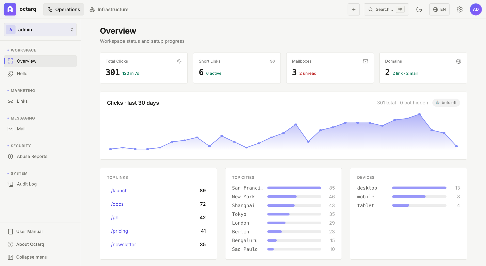
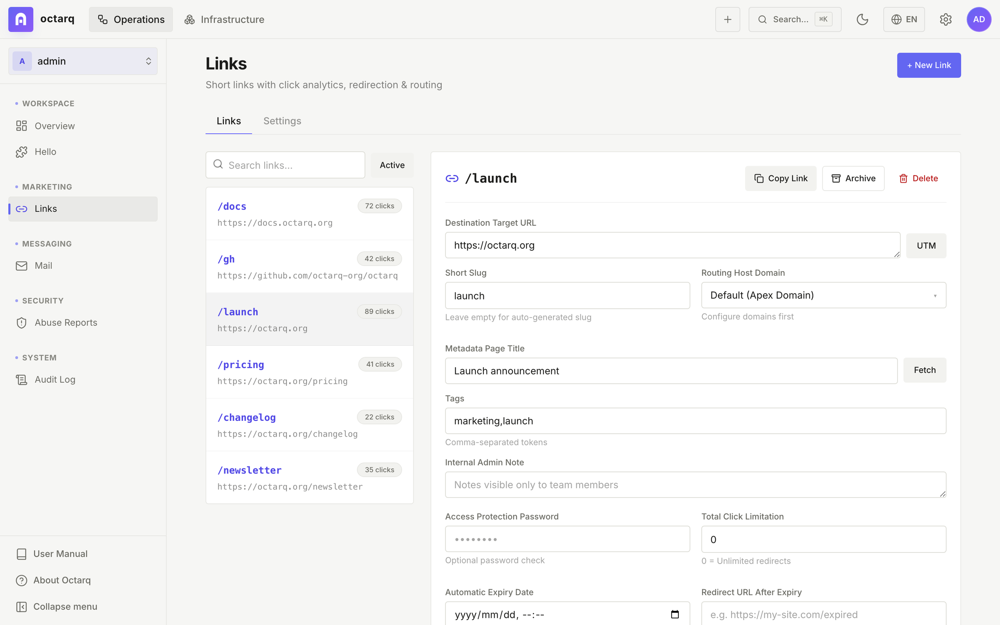
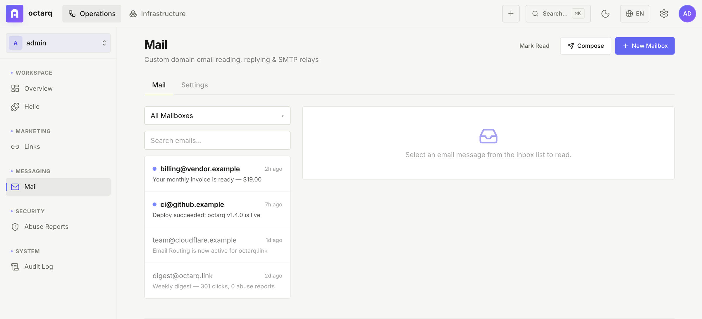
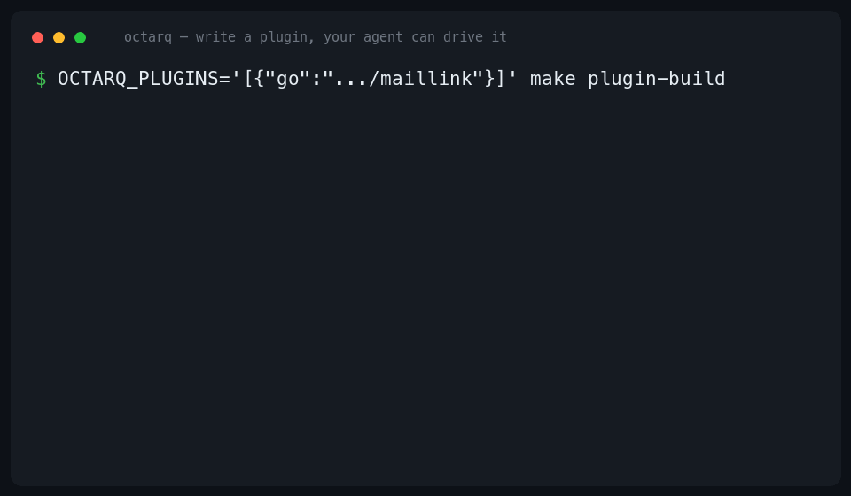

<p align="center">
  <picture>
    <source media="(prefers-color-scheme: dark)" srcset="assets/banner-dark.png">
    
  </picture>
</p>

<p align="center">
  <b>单二进制。只做基础设施，不做业务功能。短链、邮件与 DNS 以插件形式接入 —— 并让 AI Agent 通过 MCP 驱动这一切。</b>
</p>

<p align="center">
  <a href="https://github.com/octarq-org/octarq/actions/workflows/ci.yml"></a>
  <a href="https://github.com/octarq-org/octarq/actions/workflows/ci.yml"></a>
  <a href="server/go.mod"></a>
  <a href="https://pkg.go.dev/github.com/octarq-org/octarq/server"></a>
  <a href="https://modelcontextprotocol.io"></a>
</p>

<p align="center">
  <a href="https://octarq.org">官网</a> ·
  <a href="https://docs.octarq.org">文档</a> ·
  <a href="#快速开始">快速开始</a> ·
  <a href="blueprints/autonomous-solopreneur/README_ZH.md">一人公司样板间</a> ·
  <a href="#插件扩展开发编写一个插件">编写插件</a> ·
  <a href="https://github.com/octarq-org/octarq-plugins">插件仓库</a> ·
  <a href="README.md">English</a>
</p>

---

## Octarq 是什么？

Octarq 是**一个由你自行组装的自托管后台**，面向独立开发者、一人公司与 AI-native 小团队。一个 Go 二进制提供后台所需的全部基础层，业务功能按需挂载在上面。

**核心层提供什么**（其中没有任何业务功能）：

| 层 | 你会拿到 |
| --- | --- |
| 身份 | 登录、API Token、工作区、角色，以及按租户隔离的数据库层 |
| 运维 | 审计日志、通知、后台任务队列、Webhooks、备份 |
| Agent | MCP 服务器、按工具的风险等级、租户视图上的只读 SQL、分级门禁 |
| 平台 | Go 与 React 的插件 SDK、嵌入式后台、OpenAPI 导出、租户 SQL 视图 |

业务功能在 [octarq-plugins](https://github.com/octarq-org/octarq-plugins)：短链、邮件、DNS 与 2FA 保险库。按需在构建时加入。其余部分同样扩展：**一个轻量的 Go 接口 + 一个 React 页面 = 一个全新的后台工具**。由于 Octarq 原生支持 **MCP**，你编写的每一个插件都能被 AI Agent（如 Claude Code、Cursor、Claude Desktop）直接驱动。

三种用法：

1. **直接运行** —— `docker compose up -d --build`，然后登录。
2. **组装构建** —— `OCTARQ_PLUGINS='[...]' make plugin-build`，不改代码就能挑选插件。
3. **编写插件** —— 三个 Go 方法加一个 React 页面，数据库、鉴权、审计、MCP 与后台外壳全都现成。

> 单二进制。无 CGO。默认 SQLite 存储。嵌入式 React 管理后台 (`go:embed`)。无需 Fork 自由扩展。

<p align="center">
  
</p>

---

## 快速开始

Octarq 不发布容器镜像：有用的构建要带上你选的插件，所以由你自己构建。Docker Compose 会用这棵树构建二进制与管理后台：

```bash
git clone https://github.com/octarq-org/octarq && cd octarq
docker compose up -d --build
```

不用 Docker 时直接构建二进制：

```bash
make release                                                # 构建 ./octarq，管理后台已嵌入
OCTARQ_SECRET_KEY=… OCTARQ_ADMIN_PASSWORD=… ./octarq        # 监听 :8080
```

未设置环境变量时，首次启动 Octarq 会生成密钥与初始 `admin` 密码，两者都保存在 `/data` 卷里。取出密码：

```bash
docker compose cp octarq:/data/octarq-admin-password.txt .
cat octarq-admin-password.txt
```

打开 `http://localhost:8080` 登录。

默认构建只含基础设施。需要的业务插件从 [octarq-plugins](https://github.com/octarq-org/octarq-plugins) 加入后重新构建，见[插件扩展开发](#插件扩展开发编写一个插件)。只想打包现成二进制的最小镜像见 [`deploy/Dockerfile.binary`](deploy/Dockerfile.binary)。

---

## 为什么选择 Octarq

- **一个二进制，一个下午。** 下载、运行、扩展。无需安装运行时，无需拼接服务，无 CGO。
- **核心是基础设施。** 鉴权、工作区、审计日志、通知、Webhooks、任务队列、MCP —— 每个后台都要用的部分，没有多余功能。
- **业务功能是插件。** 短链、邮件、DNS 与 2FA 放在 [octarq-plugins](https://github.com/octarq-org/octarq-plugins)，构建时挂载。它们用的是和你一样的公开接口。
- **原生面向 Agent。** 每个插件的能力无需额外胶水即可通过 MCP 交给你的 AI Agent 驱动。
- **完全属于你。** 你的服务器、你的数据库、你的域名，MIT 协议。

---

## 业务插件

从 [octarq-plugins](https://github.com/octarq-org/octarq-plugins) 安装：

| 插件 | 能力 |
| --- | --- |
| **🔗 短链接 Links** | 自定义/随机 slug，地理/设备/OS/语言动态分流路由，过期机制与点击上限，过期 URL 兜底，带机器人过滤的时序数据分析，UTM 构造器，二维码，标签管理（支持可选 MaxMind GeoIP）。 |
| **✉️ 邮箱路由 Mail** | 基于 Cloudflare Email Routing 的 Serverless 邮件接收（无需开启 25 端口，无垃圾邮件守护进程），Catch-all 自动建箱，完整邮件客户端（读件/回复/通过自定义 SMTP relays 发信，下载原始 `.eml`），按需 AI 邮件摘要（BYO key）。 |
| **🌐 DNS 管理** | Cloudflare 与 DNSPod CRUD 操作，短链接与邮件认证 presets（MX/SPF/DKIM），原生备注/注释映射。 |
| **🔐 2FA 保险库** | 共享基础设施账号（云厂商、域名注册商、GitHub）的 TOTP 验证码，AES-256-GCM 静态加密，带审计轨迹与 MCP 工具。 |
| **🧩 Mail Links** | 「看看插件能做什么」的演示：邮件到达后 Octarq 自动缩短其中第一个链接，AI Agent 经 MCP 取用。 |

<details>
<summary>看看短链与邮件插件的实际界面</summary>

<p align="center">
  
  <br><br>
  
</p>
</details>

鉴权、工作区与 RBAC、审计日志、通知、任务队列、Webhooks、备份属于核心，且对你编写的每一个插件开放。

---

## Agent-Native：你的插件即 MCP 工具

Octarq 内置了 **MCP 服务器**（`octarq mcp` 走 stdio；服务器自身在 `/api/mcp/sse` 与 `/api/mcp/stream` 提供 SSE 与 Streamable HTTP），AI 助手（如 Claude Code）可以直接读取并查询你的实例能力。核心提供 `octarq_infra__describe_tenant_schema`、`octarq_infra__query_db_readonly`、`octarq_infra__export_data` 与 `octarq_infra__notify`；已安装的插件会加入自己的命名空间工具，例如 `octarq_network__list_links`。所有工具均通过 `org_id` 严格限定在调用方自己的工作区内；SQL 访问仅允许 SELECT 且敏感列会被脱敏，同名工具重复注册会直接失败而非静默覆盖。

重点不在于"我们加入了 AI"，而在于**框架级别的管线机制**：实现可选 `MCPProvider` 接口的插件会自动将其工具暴露给所有连接的 AI Agent —— 无需额外胶水代码。编写一个插件，你的 AI Agent 就能直接驱动它。

```
📬 收到新的 OTP 验证码邮件 ──▶ 你编写的 10 行插件 (OnEmail hook)
                                ├─ 自动生成短链接 (links 服务)
                                └─ 暴露为 MCP 工具 ──▶ Claude Code 直接消费使用
```

<p align="center">
  
</p>

<details>
<summary>Claude Desktop MCP 配置</summary>

```json
{ "mcpServers": { "octarq": {
  "command": "/path/to/octarq", "args": ["mcp"],
  "env": { "OCTARQ_DB_DSN": "/path/to/octarq.db" }
}}}
```
</details>

> 🌟 **官方开源样板间**：想要直观体验 AI 智能体如何驱动 Octarq？请查看 [**《一人公司自运行智能体 (Autonomous Solopreneur)》可执行脚手架**](examples/autonomous-solopreneur/) (`examples/autonomous-solopreneur`) —— 完整演示 Claude Code 与 Cursor 如何通过 Remote MCP 自动化接管 DNS 信誉诊断、UTM 营销短链配置、业务邮箱 OTP 拦截与离线 Ed25519 授权签发。另附 [工作流架构设计与操作手册](blueprints/autonomous-solopreneur/README_ZH.md)。

---

## 插件扩展开发（编写一个插件）

一个插件是一个包含前后端两个半边的仓库，在**编译期组合**（类似 `xcaddy` 模型 —— 选择插件，编译为一个二进制）。公开的 `plugin` 包就是全部契约，核心的其它部分都不打算被导入。

```go
// backend: 实现包含 3 个方法的接口，免费获得 DB/鉴权/审计/DNS/发信/缓存等能力
func (Plugin) Name() string          { return "hello" }
func (Plugin) Models() []any         { return nil }
func (Plugin) Mount(mux plugin.Mux, ctx *plugin.Context) {
    mux.Handle("GET /api/hello/ping", ctx.Guard(http.HandlerFunc(pong)))
}
```

```ts
// frontend: 基于共享 SDK 编写 React 页面 — 样式与应用统一，自带无障碍支持
export const helloPlugin: UIPlugin = {
  name: "hello",
  routes: [{ path: "/hello", Component: lazy(() => import("./Page")) }],
};
```

- **绝不 Fork，绝不 import `internal/*`** —— 一切能力尽在 `plugin.Context`（DB, Guard, Encrypt, Audit, Notify, SendMail, OnEmail, DNS, cache, geo, webhooks, job queue…），且支持向下兼容演进。
- **路由自动门禁**（未启用时响应 404），**插件间通过 Service Registry 通信**（无直接 Cross-Import），**模型自动 AutoMigrate**。
- **无须修改代码即可组合自定义二进制** —— xcaddy 式驱动：
  ```bash
  OCTARQ_PLUGINS='[{"go":"github.com/you/octarq-plugin-foo","npm":"@you/octarq-plugin-foo"}]' make plugin-build
  ```

**几秒生成骨架** —— `octarq plugin new <name>` 直接生成可构建的 Go + web 插件骨架作为起点。

**官方插件与起步模板** → [octarq-plugins](https://github.com/octarq-org/octarq-plugins)（links、mail、DNS、2FA 保险库、agent-native 的 Mail Links demo，以及可复制的 `_template`） · **详细开发指南** → [插件编写指南](https://docs.octarq.org/writing-a-plugin/)

*Octarq 自己的商业 Pro 版也只是基于这同一套公开接口构建的另一组插件 —— 没有任何社区做不到的事情。*

---

## 配置指南

- **通过 Cloudflare Worker 接收邮件** —— 部署 [`deploy/cloudflare-email-worker.js`](deploy/cloudflare-email-worker.js)，配置 catch-all 路由，并开启 *Accept email*。
- **GeoIP 地理位置统计** —— 设置 `OCTARQ_MAXMIND_LICENSE_KEY`（免费），Octarq 会自动下载并热加载 GeoLite2。参阅 [`deploy/GEOIP.md`](deploy/GEOIP.md)。
- **Claude Desktop 配置 MCP** —— 在 `claude_desktop_config.json` 中指向 `octarq mcp`（配置见上）。
- **备份与恢复** —— `octarq backup` / `octarq restore` 备份数据库。请备份整个 `/data` 目录（数据库 **以及** 自动生成的 `octarq.secret` / `octarq-admin-password.txt` 密钥文件），并注意 Postgres 备份需要宿主机上的 `pg_dump`。参见 [备份与恢复](https://docs.octarq.org/backup-restore/)。

---

## 本地开发

```bash
make dev                                                  # 后端 (Air 热重载) + Vite 前端开发服务
# 或分别单独启动:
(cd server && OCTARQ_SECRET_KEY=dev OCTARQ_ADMIN_PASSWORD=dev-admin-password go run .)
(cd server && go test ./... -race)
```

欢迎贡献代码 —— 参见 [CONTRIBUTING.md](CONTRIBUTING.md)。

---

## 开源协议

基于 [MIT 协议](LICENSE) 开源。
