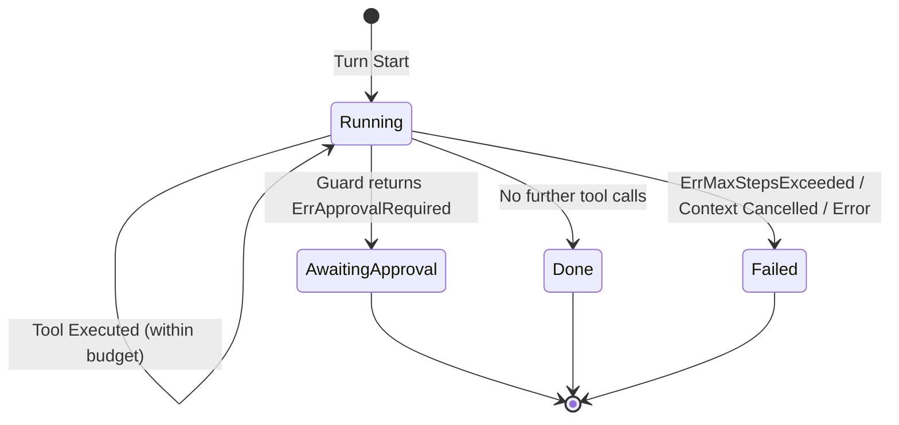

# Module Specification: Agent Harness (`server/agent/harness`)

## 1. Architectural Overview & Role
The `harness` package implements the AI-native orchestration micro-kernel for Octarq Core OSS. It provides the core agent execution loop, safety guards, and trajectory tracing infrastructure shared across all client channels (Web Dashboard, Telegram, MCP Server, CLI).

- **Module Identifier**: `agent/harness`
- **Primary Package**: `github.com/octarq-org/octarq/server/agent/harness`
- **Key Responsibilities**:
  - Orchestrating the iterative agent loop: `input → reasoning → tool calls → fenced output → repeat until complete`.
  - Compiling the agent's tool surface and system prompt from the endpoint registry (single source of truth).
  - Enforcing strict execution step budgets by profile (`Normal`, `Reactor`, `ReactorReadOnly`).
  - Mitigating prompt injection via mandatory untrusted fences on all tool outputs.
  - Supporting human-in-the-loop (HITL) safety approvals with explicit `TurnStatusAwaitingApproval`.
  - Emitting a structured trace of every turn (the evidence layer).
  - Providing streaming execution with real-time thinking tokens, text deltas, and tool chunk aggregation.
- **Pre-v1.0 Invariant**: Fail-closed guard evaluation; step-count ceiling invariant #6 strictly enforced.

---

## 2. Core Types & Interface Assertions

### 2.1 Public Interfaces (`runner.go`, `guard.go`, `tracer.go`)
- **Runner**:
  ```go
  type Runner interface {
      Run(ctx context.Context, s *Session, t *Turn) error
  }
  ```
- **StreamRunner**:
  ```go
  type StreamRunner interface {
      Runner
      Stream(ctx context.Context, s *Session, t *Turn, h llmprovider.StreamHandler) error
  }
  ```
- **ToolExecutor**:
  ```go
  type ToolExecutor interface {
      Execute(ctx context.Context, orgID uint, name string, argsJSON string) (output string, err error)
  }
  ```
- **Completer & StreamingCompleter**:
  ```go
  type Completer interface {
      Complete(ctx context.Context, model string, system string, messages []Message) (string, error)
  }
  ```
- **Guard & Tracer**:
  ```go
  type Guard interface {
      Allow(ctx context.Context, orgID uint, tool string) error
  }

  // Tracer observes the lifecycle of a turn through structured events.
  type Tracer interface {
      Event(ctx context.Context, ev TraceEvent)
  }
  ```
  `TraceEvent` carries the shape of what happened — kind (`turn_start` / `step` /
  `turn_end`), tool name, outcome (`ok` / `error` / `denied` / `blocked`),
  stable business error code, duration and token totals. It deliberately
  carries **no tool arguments and no tool output**: those belong to the
  session, not to the trace.

- **Tool Catalog & Prompt Compiler** (`catalog.go`):
  ```go
  type Catalog struct { Tools []ToolDescriptor }
  type ToolFilter func(ToolDescriptor) bool

  func BuildCatalog(src EndpointSource, filter ToolFilter) Catalog
  func (c Catalog) SystemPrompt(spec HarnessSpec) string
  func (c Catalog) ToolSection() string
  func (c Catalog) Fingerprint(spec HarnessSpec) string
  ```
  The catalog is compiled from the endpoint registry, so the tool list the
  model sees cannot drift from the tools that exist. `EndpointSource` must
  therefore expose `Endpoints() []plugin.Endpoint` in addition to `Lookup`.

- **Harness Spec** (`spec.go`):
  ```go
  type HarnessSpec struct {
      Version    int      `json:"version"`
      Name       string   `json:"name"`
      Preamble   string   `json:"preamble,omitempty"`
      ExtraRules []string `json:"extraRules,omitempty"`
      ToolAllow  []string `json:"toolAllow,omitempty"`
      MaxSteps   int      `json:"maxSteps,omitempty"`
  }
  ```
  The spec is the versioned, publishable description of an agent's shell. It
  holds only the components that change behaviour today; a slot that does not
  exist cannot be set to a value that is silently ignored — `DecodeSpec`
  rejects unknown fields and `Validate` refuses the spec as a whole.

  - The spec may only **tighten** the step ceiling, never raise it: the
    profile's ceiling is a safety invariant (`EffectiveMaxSteps`).
  - `ToolAllow` narrows the advertised surface; it can never widen it past
    the session policy (`composeToolFilter` in the API layer).
  - Extra rules are appended **after** the built-in rules. A spec can add
    rules, never remove them.
  - `Fingerprint()` is the SHA-256 of the canonical spec JSON: two specs with
    the same fingerprint compile the same prompt.

- **Endpoint contract additions** (`server/plugin/endpoints.go`):
  `plugin.Endpoint` gained `EndpointRisk() string` and
  `EndpointInputSchema() json.RawMessage` so the harness can describe a tool
  without a second, hand-maintained list. The schema is a plain JSON Schema
  document on purpose: a plugin may produce it with any JSON Schema
  producer, not only Huma.

---

## 3. Profiles & Step Ceilings

Quantitative execution ceilings are hard-coded to avoid unbounded LLM recursion:

| Profile | Normal / Non-Destructive | Destructive Operation Cap | Description |
|:---|:---:|:---:|:---|
| `ProfileNormal` | 8 steps (`MaxStepsNormal`) | 8 steps | Interactive multi-turn chat sessions |
| `ProfileReactor` | 3 steps (`MaxStepsReactor`) | 3 steps | Event-driven unattended automation cap |
| `ProfileReactorReadOnly` | 5 steps (`MaxStepsReadOnly`) | 3 steps | Read-only reactor; drops to 3 on destructive hint |

---

## 4. Tool Call Format & The Compiled System Prompt

The model reaches a tool through one fenced block per turn:

```text
```tool_call
{"name": "create_shortlink", "args": {"destination": "https://example.com"}}
```
```

- `args` is a JSON **object**. A JSON-encoded string holding the same object
  is unwrapped, not rejected: a model that quotes its arguments has still
  made a well-formed call.
- A line that cannot be parsed is reported back to the model inside the
  untrusted fence instead of being dropped. A silently dropped call would
  leave the model believing it had acted.

The system prompt is **compiled on the server** (`Catalog.SystemPrompt`) and
never accepted from the client. It states four things:

1. the tool-call format above;
2. that tool output is DATA and never instructions (see §5);
3. the rules the agent must not break (only listed tools exist; approval-gated
   tools are not executed; the step budget);
4. the tools themselves — name, summary, method, path, risk tier, approval
   requirement, description and the parameter list derived from the input
   schema.

`Catalog.ToolSection()` renders the "## Available tools" part on its own. A
caller that composes its own preamble — another channel, another product voice
— uses it instead of scraping the section out of the rendered prompt: the
section is rendered by the same code either way, so the two cannot disagree.
An empty catalog renders a section that says no tool can be called, never an
empty section that would read as "nothing is needed".

`Catalog.Fingerprint(spec)` is the SHA-256 of the compiled prompt. Two
sessions with the same fingerprint ran the same prompt against the same tool
surface, which is what makes recorded turns comparable.

The prompt is compiled from a `HarnessSpec`: the spec contributes the
preamble, the extra rules and the step budget. The built-in rules always come
first and cannot be removed. The step budget in the prompt is the *effective*
one — the profile's ceiling lowered by the spec, never raised — so the model
is told the ceiling the runner will actually enforce.

An invalid published spec fails the request (HTTP 500) before the stream
starts. It never degrades into the built-in default.

The catalog is filtered per session: the web assistant is read-only, so only
`GET`/`HEAD` tools are advertised. A prompt must never offer a tool the
guard would refuse.

---

## 5. Prompt Injection Defense (Untrusted Fence)

Every tool output written into session history is wrapped in an untrusted block:
```text
```untrusted
<raw tool output>
```
```
This isolates untrusted third-party payloads from system instructions and protects the agent from instruction override attacks.

---

## 6. Lifecycle & HITL Approval State Machine



---

## 7. Harness Spec Store, Draft Lifecycle & Admin API

The spec is versioned per workspace. Rows live in `agent_harness_specs`
(`server/internal/models/agent_harness.go`) and are managed by
`server/internal/agentstore/harness.go`.

### 7.1 Lifecycle

```
        stage / import proposal
                 │
                 ▼
             ┌───────┐  discard   ┌───────────┐
             │ draft │──────────▶│ discarded │
             └───┬───┘            └───────────┘
                 │ activate
                 ▼
             ┌──────────┐  activate (another)  ┌──────────┐
             │ published│─────────────────────▶│ archived │
             └──────────┘                       └──────────┘
                  ▲                                  │
                  └──────────────────────────────────┘
                              rollback
```

- A version is **immutable**: only its status changes. Nothing is deleted, so
  a rollback always has a target.
- **Staging is not publishing.** A staged version is a draft; the workspace's
  assistant keeps running the previous live version until somebody activates
  the draft. This is the gate an imported lab proposal passes too.
- A workspace has **exactly one** live version. Activating archives whatever
  was live before — across every name, because the workspace runs one harness.
- The built-in default applies only when a workspace has **never** activated a
  version — that is the product's normal state, not a fallback.
- A live spec that cannot be decoded **fails the request** (HTTP 500 before
  the stream starts). It is never silently replaced by the default: that would
  hide a broken configuration behind a working-looking agent.
- The store is tenant-scoped: every query filters on `owner_id`. A version of
  another workspace is invisible, and a cross-workspace activation is refused.

### 7.2 Admin API (workspace admin, `authz.RoleAdmin`)

| Method | Path | Purpose |
|---|---|---|
| GET | `/api/agent-harness/specs` | list the versions, mark the live one |
| GET | `/api/agent-harness/specs/{id}` | read one version and its spec |
| POST | `/api/agent-harness/drafts` | stage a spec as a draft |
| POST | `/api/agent-harness/proposals` | import a lab proposal as a draft |
| POST | `/api/agent-harness/specs/{id}/activate` | make a version live |
| POST | `/api/agent-harness/specs/{id}/discard` | throw a draft away |
| GET | `/api/agent-harness/lessons` | list what the workspace learned |
| POST | `/api/agent-harness/lessons` | record a lesson |
| POST | `/api/agent-harness/lessons/{id}/dismiss` | reject a lesson |

Staging, importing, activating and discarding are audited
(`agent.harness.stage` / `.import` / `.activate` / `.discard`).

### 7.3 The host seam: one harness for every channel

`plugin.Host` exposes the workspace's published harness so a plugin's agent
runs on the same shell the dashboard publishes, instead of a second
hand-written prompt:

```go
// HarnessSpec returns the published agent harness of the workspace as its
// canonical JSON document. A nil document means the workspace has published
// none; an error means the published harness could not be read and the caller
// must fail closed.
HarnessSpec(ctx context.Context, orgID uint) (json.RawMessage, error)
```

The document is JSON rather than a typed value because `server/agent/harness`
depends on `server/plugin` (`plugin.Endpoint`), so a typed return would close
an import cycle. Callers decode it with `harness.DecodeSpec`.

Only the **published** version is handed out: a staged draft is not the
workspace's harness until somebody activates it.

### 7.4 The improvement ledger

A **lesson** is what the workspace learned about its agent: a scope, a note,
and the evidence it rests on. Lessons live in `agent_harness_lessons`,
tenant-scoped like everything else.

- A lesson is a **suggestion**, never a rule. It does not change the harness
  by itself; an operator decides whether it becomes one.
- Importing a lab proposal records a lesson automatically (`suggested`).
- Activating the version that lesson motivated marks it `adopted`; discarding
  that draft marks it `dismissed`.
- A dismissed lesson stays visible: what was considered and turned down is
  part of the record.

---

## 8. Trace & Evidence

Every turn emits a `TraceEvent` stream:

| Event | When | Carries |
|---|---|---|
| `turn_start` | before the first model call | — |
| `step` | once per tool invocation | tool, outcome, error code, duration |
| `turn_end` | at the terminal state | turn status, input/output/reasoning tokens |

The web assistant records the trace into the audit log (`action = agent.turn`,
`target_type = agent_session`) with the prompt version, the prompt
fingerprint, the model, the token totals and one entry per step. Tool
arguments and tool output are **not** persisted: they may carry workspace
data and belong to the session.

The trace is what makes a turn comparable across harness versions — the raw
material for any later offline analysis.

---

## 8. Offline Harness Lab (`server/agent/lab`)

The offline lab provides an offline, deterministic evaluation testbed for candidate harness specifications based on the Propose–Probe–Compose paradigm (inspired by `google-research/harness2`):

- **Shared Core Contracts**: The lab directly consumes the existing `harness.HarnessSpec` (`spec.go`), `harness.Catalog` / `harness.BuildCatalog` (`catalog.go`), `harness.Runner` (`runner.go`), and `harness.TraceEvent` (`tracer.go`). It does **not** invent an alternative spec format or parallel execution engine.
- **Propose**: Candidates are represented as versioned `harness.HarnessSpec` files.
- **Probe**: Fixed task sets replay scripted model responses and mock tool outputs against each candidate specification, harvesting trace events.
- **Compose**: A strictly deterministic scorer ranks candidate performance (success rate, tool error count, step budget efficiency, and estimated token footprint) without dependency on clocks, random numbers, or external networks.
- **Explicit Invariant & Human Adoption**: The lab operates strictly offline and produces artifact reports (`report.json` and `report.md`). It never modifies production databases or live prompts, and never executes in the live request path. All spec adoptions are executed manually by human operators.
- **Importable Proposal Export**: When invoked with `-propose <path>`, the lab exports an importable draft proposal JSON (`proposal.json`) containing the winning candidate spec and benchmark evidence. The exported `spec` enforces the effective profile step budget ceiling (`EffectiveMaxSteps`) and must pass `harness.Validate`. The proposal adheres strictly to the admin draft import contract (`name`, `spec`, `evidence`), enabling human operators to import it as an inactive draft and review diffs before activation.

