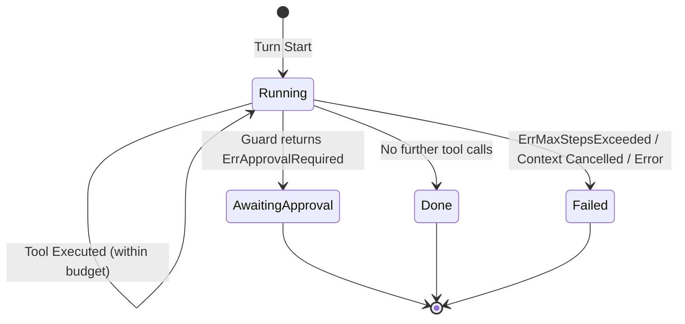

# Module Specification: Agent Harness (`server/agent/harness`)

## 1. Architectural Overview & Role
The `harness` package implements the AI-native orchestration micro-kernel for Octarq Core OSS. It provides the core agent execution loop, safety guards, and trajectory tracing infrastructure shared across all client channels (Web Dashboard, Telegram, MCP Server, CLI).

- **Module Identifier**: `agent/harness`
- **Primary Package**: `github.com/octarq-org/octarq/server/agent/harness`
- **Key Responsibilities**:
  - Orchestrating the iterative agent loop: `input → reasoning → tool calls → fenced output → repeat until complete`.
  - Enforcing strict execution step budgets by profile (`Normal`, `Reactor`, `ReactorReadOnly`).
  - Mitigating prompt injection via mandatory untrusted fences on all tool outputs.
  - Supporting human-in-the-loop (HITL) safety approvals with explicit `TurnStatusAwaitingApproval`.
  - Providing streaming execution with real-time thinking tokens, text deltas, and tool chunk aggregation.
- **Pre-v1.0 Invariant**: Fail-closed guard evaluation; step-count ceiling invariant #6 strictly enforced.

---

## 2. Core Types & Interface Assertions

### 2.1 Public Interfaces (`runner.go`, `guard.go`, `tracer.go`)
- **Runner**:
  ```go
  type Runner interface {
      Run(ctx context.Context, s *Session, t *Turn) error
  }
  ```
- **StreamRunner**:
  ```go
  type StreamRunner interface {
      Runner
      Stream(ctx context.Context, s *Session, t *Turn, h llmprovider.StreamHandler) error
  }
  ```
- **ToolExecutor**:
  ```go
  type ToolExecutor interface {
      Execute(ctx context.Context, orgID uint, name string, argsJSON string) (output string, err error)
  }
  ```
- **Completer & StreamingCompleter**:
  ```go
  type Completer interface {
      Complete(ctx context.Context, model string, system string, messages []Message) (string, error)
  }
  ```
- **Guard & Tracer**:
  ```go
  type Guard interface {
      Allow(ctx context.Context, orgID uint, tool string) error
  }

  type Tracer interface {
      StepStart(ctx context.Context, stepID string)
      StepEnd(ctx context.Context, stepID string, err error)
      TurnEnd(ctx context.Context, turnID string, status TurnStatus)
  }
  ```

---

## 3. Profiles & Step Ceilings

Quantitative execution ceilings are hard-coded to avoid unbounded LLM recursion:

| Profile | Normal / Non-Destructive | Destructive Operation Cap | Description |
|:---|:---:|:---:|:---|
| `ProfileNormal` | 8 steps (`MaxStepsNormal`) | 8 steps | Interactive multi-turn chat sessions |
| `ProfileReactor` | 3 steps (`MaxStepsReactor`) | 3 steps | Event-driven unattended automation cap |
| `ProfileReactorReadOnly` | 5 steps (`MaxStepsReadOnly`) | 3 steps | Read-only reactor; drops to 3 on destructive hint |

---

## 4. Prompt Injection Defense (Untrusted Fence)

Every tool output written into session history is wrapped in an untrusted block:
```text
```untrusted
<raw tool output>
```
```
This isolates untrusted third-party payloads from system instructions and protects the agent from instruction override attacks.

---

## 5. Lifecycle & HITL Approval State Machine


