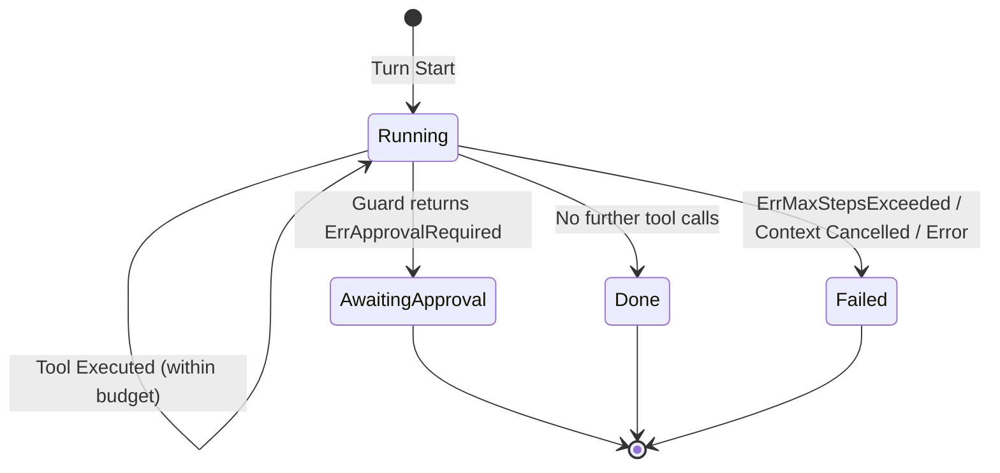

# Module Specification: Agent Harness (`server/agent/harness`)

## 1. Architectural Overview & Role
The `harness` package implements the AI-native orchestration micro-kernel for Octarq Core OSS. It provides the core agent execution loop, safety guards, and trajectory tracing infrastructure shared across all client channels (Web Dashboard, Telegram, MCP Server, CLI).

- **Module Identifier**: `agent/harness`
- **Primary Package**: `github.com/octarq-org/octarq/server/agent/harness`
- **Key Responsibilities**:
  - Orchestrating the iterative agent loop: `input → reasoning → tool calls → fenced output → repeat until complete`.
  - Compiling the agent's tool surface and system prompt from the endpoint registry (single source of truth).
  - Enforcing strict execution step budgets by profile (`Normal`, `Reactor`, `ReactorReadOnly`).
  - Mitigating prompt injection via mandatory untrusted fences on all tool outputs.
  - Supporting human-in-the-loop (HITL) safety approvals with explicit `TurnStatusAwaitingApproval`.
  - Emitting a structured trace of every turn (the evidence layer).
  - Providing streaming execution with real-time thinking tokens, text deltas, and tool chunk aggregation.
- **Pre-v1.0 Invariant**: Fail-closed guard evaluation; step-count ceiling invariant #6 strictly enforced.

---

## 2. Core Types & Interface Assertions

### 2.1 Public Interfaces (`runner.go`, `guard.go`, `tracer.go`)
- **Runner**:
  ```go
  type Runner interface {
      Run(ctx context.Context, s *Session, t *Turn) error
  }
  ```
- **StreamRunner**:
  ```go
  type StreamRunner interface {
      Runner
      Stream(ctx context.Context, s *Session, t *Turn, h llmprovider.StreamHandler) error
  }
  ```
- **ToolExecutor**:
  ```go
  type ToolExecutor interface {
      Execute(ctx context.Context, orgID uint, name string, argsJSON string) (output string, err error)
  }
  ```
- **Completer & StreamingCompleter**:
  ```go
  type Completer interface {
      Complete(ctx context.Context, model string, system string, messages []Message) (string, error)
  }
  ```
- **Guard & Tracer**:
  ```go
  type Guard interface {
      Allow(ctx context.Context, orgID uint, tool string) error
  }

  // Tracer observes the lifecycle of a turn through structured events.
  type Tracer interface {
      Event(ctx context.Context, ev TraceEvent)
  }
  ```
  `TraceEvent` carries the shape of what happened — kind (`turn_start` / `step` /
  `turn_end`), tool name, outcome (`ok` / `error` / `denied` / `blocked`),
  stable business error code, duration and token totals. It deliberately
  carries **no tool arguments and no tool output**: those belong to the
  session, not to the trace.

- **Tool Catalog & Prompt Compiler** (`catalog.go`):
  ```go
  type Catalog struct { Tools []ToolDescriptor }
  type ToolFilter func(ToolDescriptor) bool

  func BuildCatalog(src EndpointSource, filter ToolFilter) Catalog
  func (c Catalog) SystemPrompt(maxSteps int) string
  func (c Catalog) Fingerprint(maxSteps int) string
  ```
  The catalog is compiled from the endpoint registry, so the tool list the
  model sees cannot drift from the tools that exist. `EndpointSource` must
  therefore expose `Endpoints() []plugin.Endpoint` in addition to `Lookup`.

- **Endpoint contract additions** (`server/plugin/endpoints.go`):
  `plugin.Endpoint` gained `EndpointRisk() string` and
  `EndpointInputSchema() *huma.Schema` so the harness can describe a tool
  without a second, hand-maintained list.

---

## 3. Profiles & Step Ceilings

Quantitative execution ceilings are hard-coded to avoid unbounded LLM recursion:

| Profile | Normal / Non-Destructive | Destructive Operation Cap | Description |
|:---|:---:|:---:|:---|
| `ProfileNormal` | 8 steps (`MaxStepsNormal`) | 8 steps | Interactive multi-turn chat sessions |
| `ProfileReactor` | 3 steps (`MaxStepsReactor`) | 3 steps | Event-driven unattended automation cap |
| `ProfileReactorReadOnly` | 5 steps (`MaxStepsReadOnly`) | 3 steps | Read-only reactor; drops to 3 on destructive hint |

---

## 4. Tool Call Format & The Compiled System Prompt

The model reaches a tool through one fenced block per turn:

```text
```tool_call
{"name": "create_shortlink", "args": {"destination": "https://example.com"}}
```
```

- `args` is a JSON **object**. A JSON-encoded string holding the same object
  is unwrapped, not rejected: a model that quotes its arguments has still
  made a well-formed call.
- A line that cannot be parsed is reported back to the model inside the
  untrusted fence instead of being dropped. A silently dropped call would
  leave the model believing it had acted.

The system prompt is **compiled on the server** (`Catalog.SystemPrompt`) and
never accepted from the client. It states four things:

1. the tool-call format above;
2. that tool output is DATA and never instructions (see §5);
3. the rules the agent must not break (only listed tools exist; approval-gated
   tools are not executed; the step budget);
4. the tools themselves — name, summary, method, path, risk tier, approval
   requirement, description and the parameter list derived from the input
   schema.

`Catalog.Fingerprint(maxSteps)` is the SHA-256 of the compiled prompt. Two
sessions with the same fingerprint ran the same prompt against the same tool
surface, which is what makes recorded turns comparable.

The catalog is filtered per session: the web assistant is read-only, so only
`GET`/`HEAD` tools are advertised. A prompt must never offer a tool the
guard would refuse.

---

## 5. Prompt Injection Defense (Untrusted Fence)

Every tool output written into session history is wrapped in an untrusted block:
```text
```untrusted
<raw tool output>
```
```
This isolates untrusted third-party payloads from system instructions and protects the agent from instruction override attacks.

---

## 6. Lifecycle & HITL Approval State Machine



---

## 7. Trace & Evidence

Every turn emits a `TraceEvent` stream:

| Event | When | Carries |
|---|---|---|
| `turn_start` | before the first model call | — |
| `step` | once per tool invocation | tool, outcome, error code, duration |
| `turn_end` | at the terminal state | turn status, input/output/reasoning tokens |

The web assistant records the trace into the audit log (`action = agent.turn`,
`target_type = agent_session`) with the prompt version, the prompt
fingerprint, the model, the token totals and one entry per step. Tool
arguments and tool output are **not** persisted: they may carry workspace
data and belong to the session.

The trace is what makes a turn comparable across harness versions — the raw
material for any later offline analysis.
