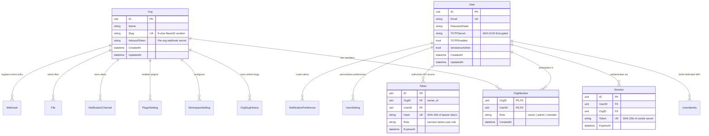

# Package Engineering Specification: `internal/models`

## 1. Scope & Responsibility

`server/internal/models` defines the authoritative GORM persistence schema for `octarq` core. It serves as the foundational data contract for the entire application, governing:
1. **Multi-Tenant Data Partitioning**: All tenant rows carry an explicit tenant foreign key (`owner_id` or `org_id`).
2. **Identity & Access Management**: Human users (`User`), OIDC federated identities (`UserIdentity`), workspace memberships (`OrgMember`), and revocable stateful sessions (`Session`).
3. **Cryptographic Secret Storage**: SHA-256 token hashing (`Token.Hash`, `User.ResetTokenHash`, `User.VerifyTokenHash`), AES-GCM encrypted TOTP secrets (`User.TOTPSecret`), and encrypted notification configurations.
4. **Tenant Address Engine**: Random, collision-resistant workspace slug generation (`AllocateOrgSlug`) with static reserved keyword guards and historical anti-squatting protections (`OrgSlugHistory`).
5. **Dynamic Runtime Configuration**: Base domain resolution (`BaseDomain`) and shared host routing (`SharedHosts`) with priority given to database settings over environment variables.
6. **Portable Structured Drivers**: JSON text columns (`StringList`, `HostList`) compatible across SQLite, PostgreSQL, and MySQL.

---

## 2. Core Entity-Relationship Architecture

---

## 3. Data Schema & Constraint Invariants

### 3.1 Table Name Overrides
To avoid SQL keyword collisions and maintain clear domain naming, specific models implement `TableName()`:
| Struct | Table Name | Rationale |
|---|---|---|
| `Session` | `user_sessions` | Prevents conflict with database `session` reserved keywords. |
| `Notification` | `notifications` | Pluralized for convention. |
| `NotificationPreference` | `notification_preferences` | Pluralized mapping. |
| `File` | `files` | Storage metadata table. |

### 3.2 Closed Model Registry (`AllModels`)
All database tables must be enumerated in `AllModels() []any` to ensure deterministic migration via `db.AutoMigrate(AllModels()...)`. The registry contains exactly 18 core models:
1. `Org`
2. `User`
3. `OrgMember`
4. `UserIdentity`
5. `UserSetting`
6. `PluginSetting`
7. `Token`
8. `Setting`
9. `WorkspaceSetting`
10. `NotificationChannel`
11. `AbuseReport`
12. `AuditLog`
13. `Webhook`
14. `Session`
15. `OrgSlugHistory`
16. `Notification`
17. `NotificationPreference`
18. `File`

---

## 4. Security & Fail-Closed Protocols

### 4.1 Token Hashing & Expiry
- API bearer tokens are NEVER stored in plaintext. `HashToken(raw)` produces a deterministic 64-character SHA-256 hexadecimal string.
- `Token.Expired()` strictly enforces `ExpiresAt.Before(time.Now())`. Nil `ExpiresAt` represents perpetual tokens (retained for backward compatibility).
- A Token inherits its holder's live membership; removing a user from an organization immediately invalidates that user's tokens for that org.

### 4.2 Workspace Slug Allocation & Collision Avoidance
- Slugs are generated from a 32-character unambiguous alphabet (`abcdefghijkmnpqrstuvwxyz23456789`) with length 8 (~40 bits of entropy).
- Slugs are strictly random and NEVER derived from user emails or organization names, preventing information leakage and squatting attacks.
- `CheckOrgSlugAvailable` evaluates against 3 independent boundary checks:
  1. Static reserved words list (`reservedOrgSlugs`: `admin`, `api`, `auth`, `login`, `billing`, etc.).
  2. Active workspace table (`orgs.slug`).
  3. Retired historical slug ledger (`org_slug_histories.slug`) to prevent post-deletion takeovers.

### 4.3 Entropy Guarantee
- `RandomSlug` enforces non-nil entropy reads from `crypto/rand.Read`. If system entropy generation fails, it fails closed via immediate panic rather than returning zeroed or predictable bytes.

---

## 5. Verification & Testing Standards

- **Characterization Lock**: `models_characterization_test.go` enforces the 18-model registry, table name mappings, slug availability states, and precedence rules.
- **Race Safety**: Verified via `go test -race ./internal/models/...`.
- **Database Portability**: Tested against in-memory SQLite and Postgres-compatible GORM drivers.
