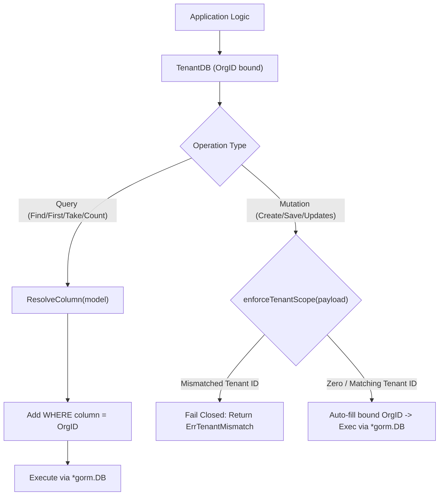
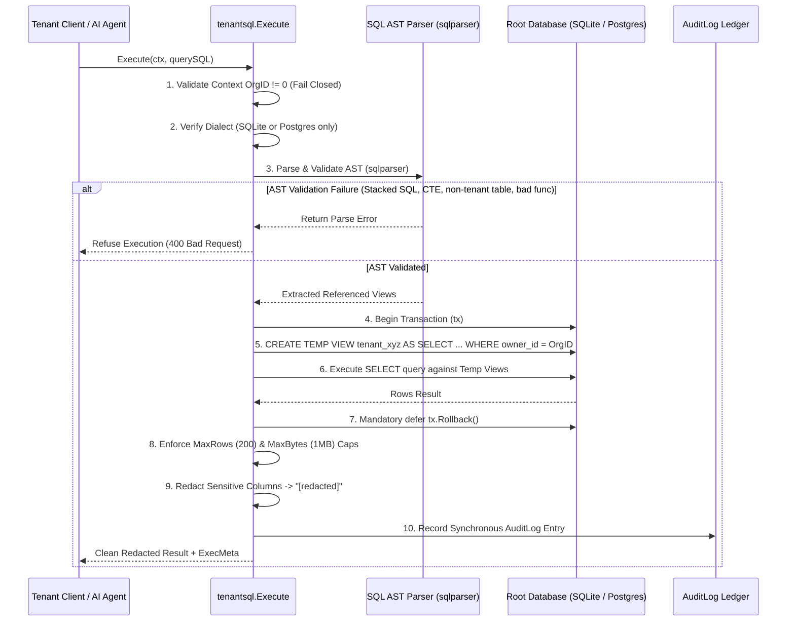

# Package Engineering Specification: `internal/tenantsql`

## 1. Scope & Responsibility

`server/internal/tenantsql` provides the multi-tenant data isolation substrate and secure SQL execution engine for `octarq`. It guarantees:
1. **Zero-Leakage Data Partitioning (`TenantDB`)**: A type-safe GORM wrapper that automatically binds all reads, writes, mutations, and transactions to a specific tenant `OrgID`.
2. **Fail-Closed Tenant Scoping**: Prevents cross-tenant writes by validating struct fields and map payloads against the bound tenant context, rejecting mismatches with `ErrTenantMismatch`.
3. **Hardened In-App SQL Runner (`Execute`)**: A 7-stage AST-validated execution engine allowing tenants to query safe, virtual views (`tenant_*`) without exposing underlying database tables or sensitive credentials.
4. **Data Redaction & Sanitization**: Automatic masking of sensitive columns (`password`, `token`, `secret`, `private_key`, `otp`, `ciphertext`) with `"[redacted]"`.

---

## 2. Architecture & Data Flow

### 2.1 TenantDB Query Wrapping Pipeline

### 2.2 In-App SQL Execution Pipeline (`Execute`)

---

## 3. Security Invariants & Fail-Closed Guards

### 3.1 TenantDB Guards
| Function | Guard Condition | Behavior |
|---|---|---|
| `NewTenantDB` | `db == nil` | Returns `ErrNilDB`. |
| `NewTenantDB` | `orgID == 0` | Returns `ErrZeroOrgID`. |
| `TenantDBFromContext` | `ctx == nil` or `OrgIDFromContext(ctx) == 0` | Returns `ErrMissingTenantContext`. |
| `Create` / `Save` / `Updates` | Struct or map contains `org_id` / `owner_id` $\neq$ bound `orgID` | Returns `ErrTenantMismatch` (write rejected, transaction aborted). |
| `Delete` | Always injects `WHERE <col> = orgID` | Prevents deleting records belonging to other tenants. |

### 3.2 SQL AST Validation Rules (`Parser.Validate`)
1. **Single Statement Only**: Multi-statement execution via semicolons or comment gluing is strictly rejected.
2. **SELECT Only**: DDL, `INSERT`, `UPDATE`, `DELETE`, `ATTACH`, `DETACH`, and `PRAGMA` are rejected.
3. **No CTEs (`WITH`)**: Common table expressions are prohibited to prevent view shadowing.
4. **No Cross-Table UNION**: `UNION` and `UNION ALL` statements are rejected.
5. **No Qualified Identifiers**: Identifiers containing database qualifiers (`main.table`, `db.table.col`) are rejected to block cross-database attacks.
6. **Mandatory Prefix**: All queried tables/views must match `tenant_*` and be explicitly registered in `Registry`.
7. **Whitelisted Functions**: Only approved mathematical, aggregation, and string functions are permitted:
   `count`, `sum`, `min`, `max`, `avg`, `coalesce`, `lower`, `upper`, `length`, `date_trunc`, `strftime`.
8. **Size Cap**: Queries exceeding `MaxSQLLength` (10KB) fail validation.

---

## 4. Verification & Testing Standards

- **Characterization Lock**: `tenantsql_characterization_test.go` locks all fail-closed constructor behaviors, context extraction, write mismatch guards, and sensitive redaction.
- **Exploit Suite**: `tenantsql_exploit_test.go` and `tenantsql_security_test.go` systematically test 22 known SQL injection and dialect bypass vectors (UNIONs, PRAGMAs, subqueries, hex encoding, oversized payloads).
- **Concurrent Registry**: `views_test.go` validates concurrent read/write access to the view registry.
- **Race Safety**: Verified via `go test -race ./internal/tenantsql/...`.
