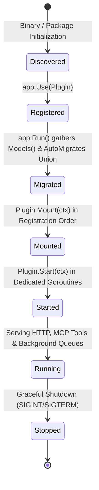

# Module Engineering Specification: `server/plugin`

## 1. Scope & System Role

`server/plugin` defines the public, compile-time SPI (Service Provider Interface) contract that all official and third-party extensions implement to extend Octarq without modifying core files.

Key responsibilities:
- **Plugin Lifecycle Orchestration**: Models declaration, atomic database migration, synchronous mounting, and asynchronous daemon startup.
- **Service Registry**: Inter-plugin decoupled service provision and dependency lookup via type-safe generics (`LookupAs[T]`).
- **Context Capability Injection**: Controlled, tenant-aware access to database, routing (`Huma`), authentication, notification, DNS, audit, and storage.
- **Event Bus (`TypedBus`)**: In-memory strongly-typed publish/subscribe messaging with panic recovery and operational logging.
- **Documentation Contract (`HelpDocsFS`)**: Declarative in-app documentation provider conventions.

---

## 2. Plugin Lifecycle State Machine



### 2.1 Lifecycle Constraints
1. **AutoMigrate Isolation**: Plugins must NEVER invoke `db.AutoMigrate()` directly. All models are returned by `Models()` and migrated atomically by `app.Run()` after registration finishes.
2. **Mount Phase Execution**: `Mount(ctx)` runs strictly once on a single goroutine in `app.Use()` order. `ctx.Provide()` is valid only during `Mount`. Duplicate service registration is a startup fatal error (**Fail-Closed**).
3. **Start Phase Execution**: Plugins implementing `Starter` have their `Start(ctx)` methods spawned in isolated goroutines after all plugins have successfully mounted.
4. **Compile-Time Assertions**: Every plugin must include compile-time assertions for all implemented interfaces:
   ```go
   var (
       _ plugin.Plugin       = (*Plugin)(nil)
       _ plugin.Starter      = (*Plugin)(nil)
       _ plugin.MenuProvider = (*Plugin)(nil)
   )
   ```

---

## 3. Capability Architecture & Service Registry

### 3.1 Service Registration & Resolution
- **Provider**: Calls `ctx.Provide("<pluginName>.<service>", serviceImpl)` during `Mount()`.
- **Consumer**: Calls `plugin.LookupAs[Interface](ctx, "<pluginName>.<service>")`.
- **Resolution Timing**: Because registration order is an application wiring detail, cross-plugin service lookups must resolve lazily in `Start()` or on a per-request basis.

### 3.2 Context & Multi-Tenant Boundary
- All tenant database interactions must obtain a tenant-isolated handle via `tenantsql.TenantDB(ctx.DB, orgID)` or context-derived helper `ctx.TenantDB(orgID)`.
- Context propagation:
  - `WithOrgID(ctx, orgID)` & `OrgIDFromContext(ctx)`
  - `WithUserID(ctx, uid)` & `UserIDFromContext(ctx)`
- MCP Tools contributed by plugins must extract `org_id` dynamically from context via `plugin.OrgIDFromContext(ctx)`. Caching `org_id` during `Mount` is strictly forbidden.

---

## 4. Failure Modes & Invariant Rules

| Invariant Rule | Violation Behavior | Required Remediation |
|---|---|---|
| **Pre-v1.0 Zero-Fallback** | Silent degradation to unauthenticated or raw DB mode | Reject operation immediately; throw error (**Fail-Closed**). |
| **Duplicate Service Registration** | Overwriting existing service in registry | Startup failure; register error in `Registry.Err()` to block boot. |
| **TypedBus Async Panic** | Silent process termination or swallowed error | Catch via `recover()`, record panic details & stack trace in server logs. |
| **Storage Path Traversal** | Accessing files outside configured base directory | Path clean & prefix check; return `os.ErrPermission` immediately. |
| **HelpDoc Missing Category** | Unknown frontmatter category | Normalize to taxonomy whitelist; log warning fallback to `"services"`. |
