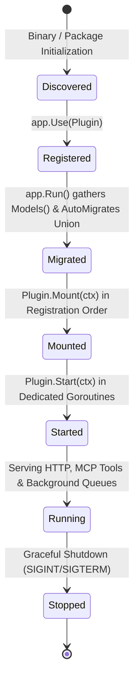

# Module Engineering Specification: `server/plugin`

## 1. Scope & System Role

`server/plugin` defines the public, compile-time SPI (Service Provider Interface) contract that all official and third-party extensions implement to extend Octarq without modifying core files.

Key responsibilities:
- **Plugin Lifecycle Orchestration**: Models declaration, atomic database migration, synchronous mounting, and asynchronous daemon startup.
- **Service Registry**: Inter-plugin decoupled service provision and dependency lookup via type-safe generics (`LookupAs[T]`).
- **Context Capability Injection**: Controlled, tenant-aware access to database, routing (`Huma`), authentication, notification, DNS, audit, and storage.
- **Event Bus (`TypedBus`)**: In-memory strongly-typed publish/subscribe messaging with panic recovery and operational logging.
- **Documentation Contract (`HelpDocsFS`)**: Declarative in-app documentation provider conventions.

---

## 2. Plugin Lifecycle State Machine



### 2.1 Lifecycle Constraints
1. **AutoMigrate Isolation**: Plugins must NEVER invoke `db.AutoMigrate()` directly. All models are returned by `Models()` and migrated atomically by `app.Run()` after registration finishes.
2. **Mount Phase Execution**: `Mount(ctx)` runs strictly once on a single goroutine in `app.Use()` order. `ctx.Provide()` is valid only during `Mount`. Duplicate service registration is a startup fatal error (**Fail-Closed**).
3. **Start Phase Execution**: Plugins implementing `Starter` have their `Start(ctx)` methods spawned in isolated goroutines after all plugins have successfully mounted.
4. **Compile-Time Assertions**: Every plugin must include compile-time assertions for all implemented interfaces:
   ```go
   var (
       _ plugin.Plugin                = (*Plugin)(nil)
       _ plugin.Starter               = (*Plugin)(nil)
       _ plugin.MenuProvider          = (*Plugin)(nil)
       _ plugin.EncryptedDataReporter = (*Plugin)(nil)
   )
   ```
5. **Encrypted Data Reporting**: A plugin that stores ciphertext only the envelope DEK can read implements `EncryptedDataReporter`. The app asks `HasEncryptedData()` after Mount when the boot had to generate a fresh DEK, and stops the boot if the answer is `true`: the key that sealed those values is gone, and serving would fail on every later read. Table names, columns, and queries stay inside the plugin.

---

## 3. Capability Architecture & Service Registry

### 3.1 Service Registration & Resolution
- **Provider**: Calls `ctx.Provide("<pluginName>.<service>", serviceImpl)` during `Mount()`.
- **Consumer**: Calls `plugin.LookupAs[Interface](ctx, "<pluginName>.<service>")`.
- **Resolution Timing**: Because registration order is an application wiring detail, cross-plugin service lookups must resolve lazily in `Start()` or on a per-request basis.

### 3.2 Context & Multi-Tenant Boundary
- All tenant database interactions must obtain a tenant-isolated handle via `tenantsql.TenantDB(ctx.DB, orgID)` or context-derived helper `ctx.TenantDB(orgID)`.
- Context propagation:
  - `WithOrgID(ctx, orgID)` & `OrgIDFromContext(ctx)`
  - `WithUserID(ctx, uid)` & `UserIDFromContext(ctx)`
- MCP Tools contributed by plugins must extract `org_id` dynamically from context via `plugin.OrgIDFromContext(ctx)`. Caching `org_id` during `Mount` is strictly forbidden.

### 3.3 Host Agent Ledger (`plugin.Host.Workforce`)

A plugin that runs agents reports to the host's ledger instead of keeping its own
budget counter and its own approval table. Two ledgers disagree the first time one
of them misses a turn, and the operator's monthly budget is the number that has to
be right.

| Method | Contract |
|---|---|
| `AuthorizeTurn` | Refuses an unknown agent, a paused agent, an unpriced model, and an exhausted budget. A model without a price is refused because a cost ceiling over it could never trip. |
| `TurnCost` | Returns the price function a plugin's own ceiling uses. It is the same price `RecordSpend` charges, so a turn that stops at its ceiling stops at the number the ledger would have billed. |
| `RecordSpend` | Prices the turn, appends the ledger row, and accrues the agent's monthly budget. A runtime turn must carry `TurnID`; a replay is refused with `ErrWorkforceSpendReplayed`. |
| `DecideApproval` | Compare-and-swap on the task's current status. A replayed or concurrent decision returns `ErrWorkforceApprovalNotPending`. |

- The ledger lives in `internal/agentstore`. A plugin cannot import it and must
  not read its tables; `app.workforceService` is the only implementation, and
  `app` mounts it on the host runtime.
- Every outcome a caller branches on is a `ErrWorkforce*` sentinel, so a plugin
  never parses a store error message. Errors the adapter does not recognise pass
  through unchanged.
- A host with no database has no ledger: every call returns
  `ErrWorkforceUnavailable`. A turn nobody can bill must not start on a
  zero-cost answer.

---

## 4. Failure Modes & Invariant Rules

| Invariant Rule | Violation Behavior | Required Remediation |
|---|---|---|
| **Pre-v1.0 Zero-Fallback** | Silent degradation to unauthenticated or raw DB mode | Reject operation immediately; throw error (**Fail-Closed**). |
| **Duplicate Service Registration** | Overwriting existing service in registry | Startup failure; register error in `Registry.Err()` to block boot. |
| **TypedBus Async Panic** | Silent process termination or swallowed error | Catch via `recover()`, record panic details & stack trace in server logs. |
| **Storage Path Traversal** | Accessing files outside configured base directory | Path clean & prefix check; return `os.ErrPermission` immediately. |
| **HelpDoc Missing Category** | Unknown frontmatter category | Normalize to taxonomy whitelist; log warning fallback to `"services"`. |
